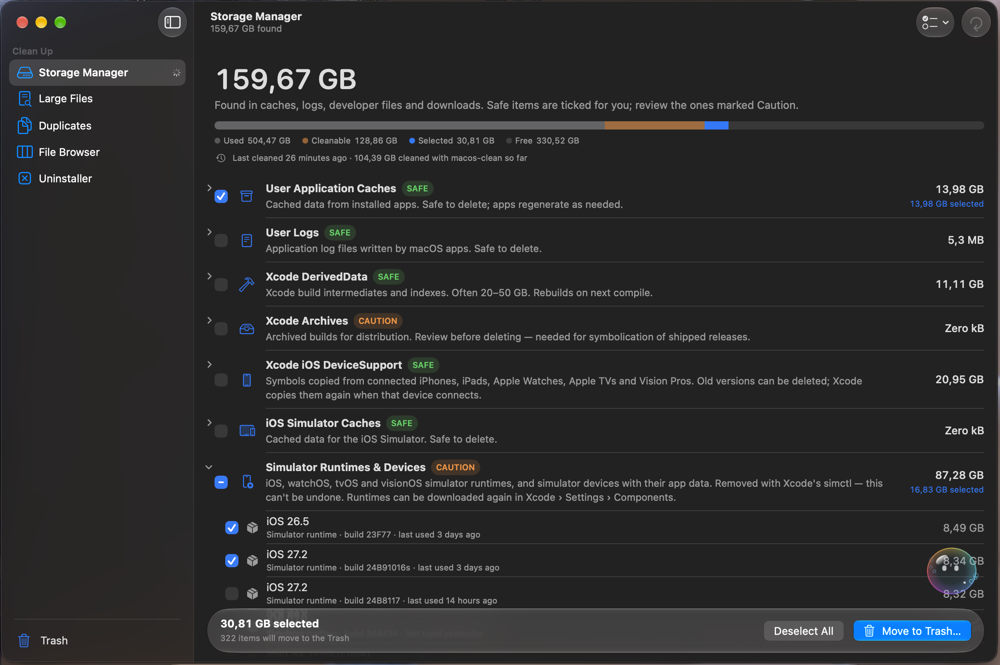

# macOS Clean

**Reclaim disk space on your Mac — safely.**

A native macOS 26 utility built with Swift 6 and SwiftUI. It finds caches, developer leftovers, large files, duplicates, and uninstalled-app remnants, then moves them to the Trash first instead of deleting them permanently.

[**Download**](https://github.com/khanhuitse05/macos-clean/releases/latest) · [Website](https://khanhto.dev/macos-clean/) · [Features](#features) · [Safety & Privacy](#safety--privacy)

 

## Why macOS Clean?

- **Built for developers**: finds Xcode, simulator, package-manager and Docker leftovers in one scan.
- **Safe by default**: everything goes to the Trash first.
- **Private**: 100% local, no telemetry. The only network request is the update check, and only when you click it.
- **Native**: pure SwiftUI, no web view.

## Features

- **Storage Manager**: 38 cleanup categories (caches, logs, Xcode, simulators, SwiftPM/npm/Bun/uv/Go/Homebrew/Gradle/Cargo, Docker, Ollama/LM Studio, git project leftovers) in **Safe** and **Caution** tiers, with search, size and age filters.
- **Large Files**: fast scan with size thresholds, exclusions and Quick Look.
- **Duplicates**: finds identical files by size and `CryptoKit` hash, skipping hard links.
- **File Browser**: multi-column view with instant folder sizes.
- **Uninstaller**: removes apps with their preferences, caches and logs, using Strict, Enhanced or Deep matching. It also finds leftovers of apps deleted long ago, and adds an "Uninstall with macOS Clean" item to Finder's Services menu.
- **Trash & History**: empty the Trash in-app, review past cleanups, and meet **Bubbl**, the mascot.
- **Menu bar monitor** (optional): free disk space, CPU or memory in the menu bar, with all three a click away.
- **Settings**: appearance (System, Light, Dark), Full Disk Access status, excluded folders, update check, and links to the GitHub repository and issue tracker.

## Safety & Privacy

- **Safe vs. Caution**: Safe items are pre-selected; Caution items never are.
- **Trash-first**: nothing is deleted directly, and protected system and home paths are refused.
- **One deletion path**: only emptying the Trash is permanent, and it can't touch anything outside `~/.Trash`.
- **100% local**: no analytics or telemetry. macOS Clean contacts GitHub only when you click **Check for Updates** in Settings › About, and sends nothing about you or your Mac.

## Download & Install

Requires macOS 26+. Universal binary (Apple Silicon & Intel), Developer ID signed and notarized.

1. Download `macos-clean.dmg` from [GitHub Releases](https://github.com/khanhuitse05/macos-clean/releases/latest) and drag **macOS Clean.app** into `/Applications`.
2. Grant **Full Disk Access** in **System Settings › Privacy & Security** so it can scan protected caches.
3. Reopen the app and run a scan.

## Contributing

Issues and pull requests are welcome — bug reports and ideas for new cleanup categories or `app_junk_db.json` entries are especially useful. Before opening a PR:

1. Run `xcrun swift test --package-path Packages/MacosCleanCore` and confirm all tests pass.
2. Build the `macos-clean` scheme in Xcode to verify `App/` compiles cleanly.

## License

Released under the [MIT License](LICENSE).
