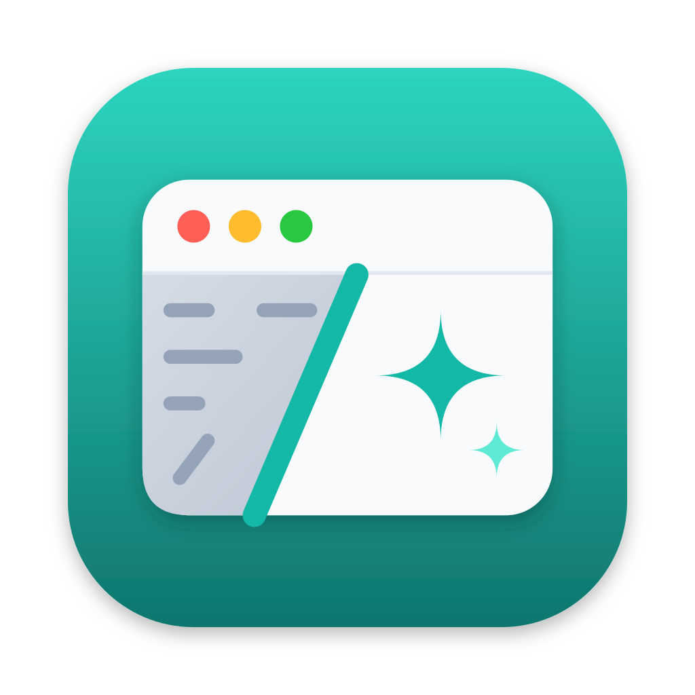
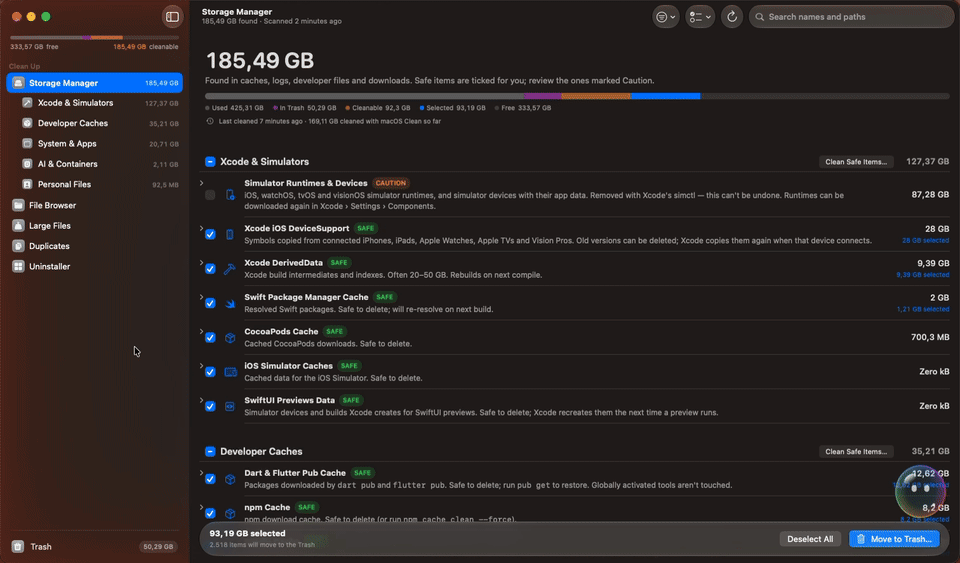

<div align="center">



# macOS Clean

**Reclaim disk space on your Mac — safely.**

A native macOS 26 utility built with Swift 6 and SwiftUI. It finds caches, developer leftovers, large files, duplicates, and uninstalled-app remnants, then moves them to the Trash first instead of deleting them permanently.

[](https://github.com/khanhuitse05/macos-clean/releases/latest)
[](LICENSE)


[**Download**](https://github.com/khanhuitse05/macos-clean/releases/latest) · [Website](https://khanhto.dev/macos-clean/) · [Features](#features) · [Safety & Privacy](#safety--privacy)

<br />



</div>

## Features

- **Storage Manager**: 38 cleanup categories in one scan: app caches and logs, Xcode and simulators, Docker, local AI models (Ollama, LM Studio), package managers (npm, Bun, uv, SwiftPM, Go, Cargo, Gradle, Homebrew) and code-project leftovers.
- **Large Files**: find big files fast, with size filters, excluded folders and Quick Look.
- **Duplicates**: finds exact copies by content hash and skips hard links.
- **File Browser**: Finder-style columns with folder sizes.
- **Uninstaller**: removes an app with its preferences, caches and logs, and finds leftovers of apps you deleted long ago. Also in Finder: right-click an app › **Services** › **Uninstall with macOS Clean**.
- **Trash & History**: empty the Trash and review past cleanups.
- **Menu bar monitor** (optional): free space, CPU or memory at a glance.

## Safety & Privacy

- **Trash first**: nothing is deleted directly. Only emptying the Trash is permanent, and that can't touch anything outside `~/.Trash`.
- **Safe vs. Caution**: Safe items are pre-selected. Caution items are only cleaned if you tick them.
- **Protected paths**: system and protected home folders are always refused.
- **100% local**: no analytics or telemetry. The only network request is **Check for Updates** in Settings › About, and only when you click it.

## Download & Install

Requires macOS 26+. Universal binary (Apple Silicon & Intel), Developer ID signed and notarized.

1. Install with [Homebrew](https://brew.sh):

   ```bash
   brew install --cask khanhuitse05/tap/macos-clean
   ```

   Or download `macos-clean.dmg` from [GitHub Releases](https://github.com/khanhuitse05/macos-clean/releases/latest) and drag **macOS Clean.app** into `/Applications`.
2. Grant **Full Disk Access** in **System Settings › Privacy & Security** so it can scan protected caches.
3. Reopen the app and run a scan.

## Contributing

Issues and pull requests are welcome — bug reports and ideas for new cleanup categories or `app_junk_db.json` entries are especially useful. Before opening a PR:

1. Run `xcrun swift test --package-path Packages/MacosCleanCore` and confirm all tests pass.
2. Build the `macos-clean` scheme in Xcode to verify `App/` compiles cleanly.

## License

Released under the [MIT License](LICENSE).
